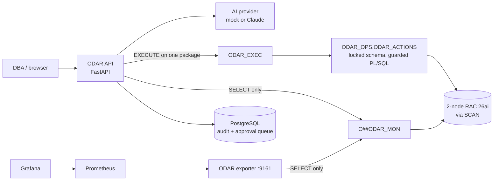

# ODAR – Oracle DBA Autonomous Operations & Resilience Platform

A home-lab platform that monitors a two-node Oracle RAC database, explains problems with an AI assistant, and runs a small set of DBA tasks — but only after a second person approves them.

It is built the way I would want such a tool to behave in production: read-only by default, least privilege everywhere, and every action recorded.

## What it does

| Area | What ODAR provides |
|---|---|
| Monitoring | Instance, PDB, service and session status across RAC nodes, read through SCAN with a SELECT-only account |
| Metrics | Prometheus exporter: instance up/down, sessions, blocked sessions, tablespace %, FRA %, ASM disk group % |
| Dashboards | Grafana "RAC Health" dashboard, provisioned from code |
| AI diagnostics | Paste an ORA error; ODAR masks hosts, IPs and secrets, adds live metrics, and returns probable causes, read-only checks and recommended actions |
| Controlled automation | Four allowlisted actions, request → approve (different person) → execute → audit |
| Audit | Every request, approval, execution and AI call written to an append-only table |

## Architecture



## Safety model

ODAR is designed so that neither the AI nor a single operator can change the database alone.

1. **Read-only by default.** `ODAR_READ_ONLY=true` blocks all execution. It is a kill switch, checked before anything else.
2. **Least privilege.** The monitoring user has CREATE SESSION plus SELECT on ten V$/CDB views. No SYSDBA, no DBA role, no ANY privileges.
3. **No free-form SQL.** Only four actions exist. Parameters must be simple Oracle identifiers or bounded integers.
4. **Guarded inside the database.** The executor can only call one PL/SQL package, owned by a schema nobody can log in to. The package re-checks every request (for example, it refuses to add datafiles to SYSTEM, SYSAUX or bigfile tablespaces).
5. **Four-eyes approval.** The person who requests an action cannot approve it. Approvals expire after 60 minutes and each request can run once.
6. **AI recommends, never acts.** Every AI-suggested action is forced to `requires_approval: true, executed: false`.
7. **Sanitized before leaving the host.** Hostnames, IPs, e-mails, passwords and quoted literals are masked before any text is sent to a cloud AI service.
8. **Append-only audit.** The application role can INSERT and SELECT the audit table, but not UPDATE or DELETE it.
9. **Secrets outside Git.** Credentials live in `/etc/odar/odar.env` (root:odar, 640).

## Allowlisted actions

| Action | Risk | Guard |
|---|---|---|
| `GATHER_TABLE_STATS` | Low | Non-Oracle-maintained schema, table must exist |
| `GATHER_SCHEMA_STATS` | Low | Non-Oracle-maintained schema |
| `ADD_DATAFILE` | Low | Smallfile, permanent, non-system tablespace; 10–1024 MB, max 4096 MB, in `+DATA` |
| `AWR_SNAPSHOT` | Low | PDB-level manual snapshot |

Not allowed by design: killing sessions, shutdown, CRS stop/start, deleting backups or archived logs, any free-text SQL.

## Stack

Oracle Linux 9 · Python 3.12 · FastAPI · python-oracledb (Thin mode, no client install) · PostgreSQL 16 · Prometheus 3 · Grafana 13 · firewalld · systemd

Target: Oracle AI Database 26ai two-node RAC (VirtualBox lab).

## Repository layout

```
odar/
  main.py            API endpoints
  config.py          settings from /etc/odar/odar.env
  oracle.py          read-only queries (Thin mode, connection pool)
  exporter.py        Prometheus exporter
  sanitizer.py       masking before AI calls
  ai/providers.py    mock and Claude providers
  ai/diagnose.py     diagnosis flow and approval enforcement
  actions.py         allowlist, approval queue, executor
  audit.py           file + PostgreSQL audit trail
deploy/              systemd units, Prometheus config, Grafana provisioning
tests/smoke.sh       one-command check (13 tests)
```

## API

| Method | Endpoint | Purpose |
|---|---|---|
| GET | `/health` | Service status, version, read-only flag |
| GET | `/oracle/health` | Overall RAC status and issues |
| GET | `/oracle/instances` `/database` `/pdbs` `/services` | RAC details |
| GET | `/ai/status` | AI provider readiness |
| POST | `/ai/diagnose` | Diagnose an error with live metrics |
| GET | `/actions/catalog` | Allowlisted actions |
| POST | `/actions/request` | Request an action |
| POST | `/actions/{id}/approve` · `/reject` | Decide (must be a different person) |
| POST | `/actions/{id}/execute` | Run an approved action |
| GET | `/actions/requests` · `/audit/recent` | Queue and audit trail |

Interactive docs are served at `/docs`.

## Database setup (summary)

On the CDB root, a common user for monitoring:

```sql
CREATE USER C##ODAR_MON IDENTIFIED BY "<password>" CONTAINER=ALL;
GRANT CREATE SESSION TO C##ODAR_MON CONTAINER=ALL;
GRANT SELECT ON SYS.GV_$INSTANCE TO C##ODAR_MON CONTAINER=ALL;
-- plus V_$DATABASE, GV_$PDBS, GV_$ACTIVE_SERVICES, GV_$SESSION, V_$CONTAINERS,
-- CDB/DBA_TABLESPACE_USAGE_METRICS, V_$RECOVERY_FILE_DEST, V_$ASM_DISKGROUP_STAT
ALTER USER C##ODAR_MON SET CONTAINER_DATA=ALL CONTAINER=CURRENT;
```

In the PDB, a locked owner schema `ODAR_OPS` holds the `ODAR_ACTIONS` package, and `ODAR_EXEC` gets only `CREATE SESSION` and `EXECUTE` on that package.

## Configuration

`/etc/odar/odar.env` (not in Git):

```
ODAR_ENV=lab
ODAR_READ_ONLY=true
ODAR_DB_DSN=postgresql://odar_app:<password>@127.0.0.1:5432/odar
ODAR_ORA_USER=C##ODAR_MON
ODAR_ORA_PASSWORD=<password>
ODAR_ORA_DSN=<scan-host>:1521/<cdb-service>
ODAR_EXEC_USER=ODAR_EXEC
ODAR_EXEC_PASSWORD=<password>
ODAR_EXEC_DSN=<scan-host>:1521/<pdb-service>
ODAR_AI_PROVIDER=mock          # or claude
ODAR_AI_API_KEY=<key>          # only when provider is claude
```

## Testing

```bash
/opt/odar/app/tests/smoke.sh
```

Runs 13 checks across the API, RAC monitoring, AI layer, approval queue, exporter, Prometheus and Grafana, and prints `ALL PASS` or the number of failures.

## Status

**v1.0** — monitoring, dashboards, AI diagnostics (mock provider), approval-gated automation.

Planned:
- RAC resilience tests (instance failure, service relocation) with ODAR capturing evidence
- Data Guard lag and broker monitoring, switchover drill
- API authentication and HTTPS

## Disclaimer

This is a personal lab project, not an Oracle product. Test anything here in a non-production environment first.

## Author

Syed Anwar Ahmed — Oracle ACE Associate · [syedanwarahmedoracle.blog](https://syedanwarahmedoracle.blog)
